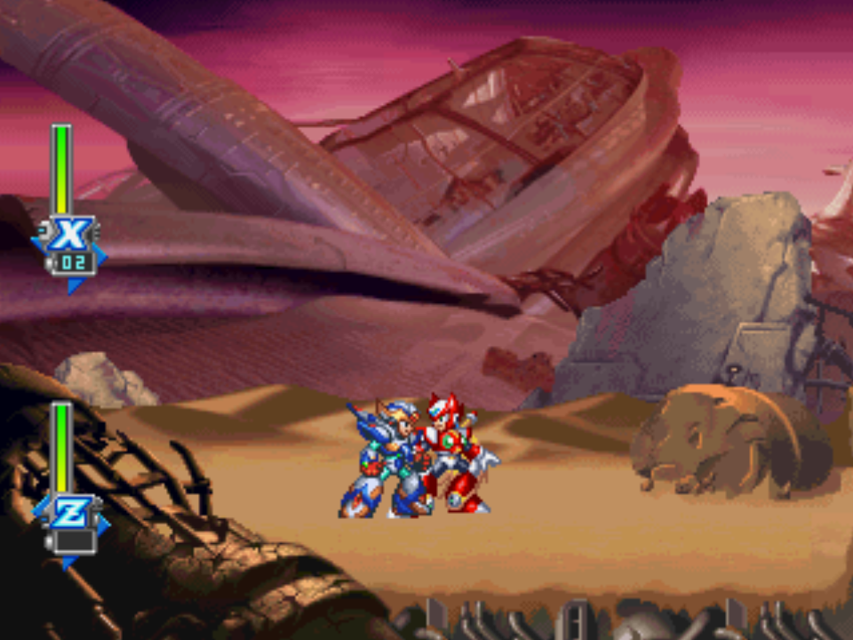
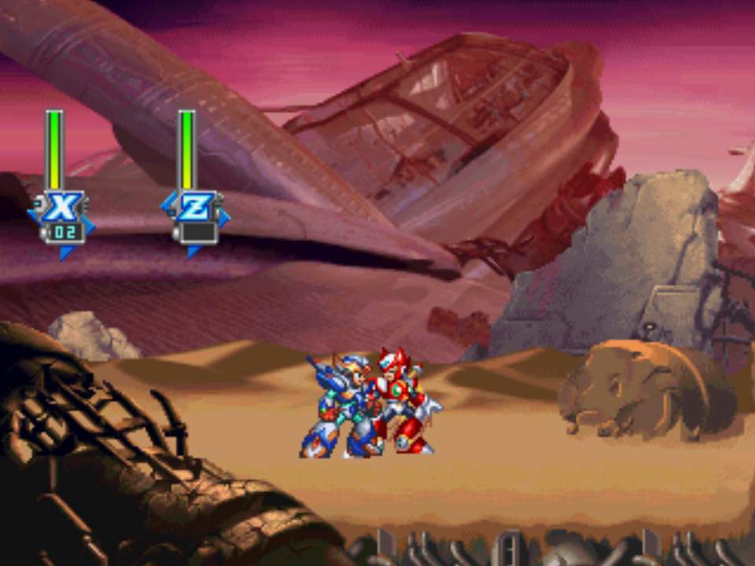
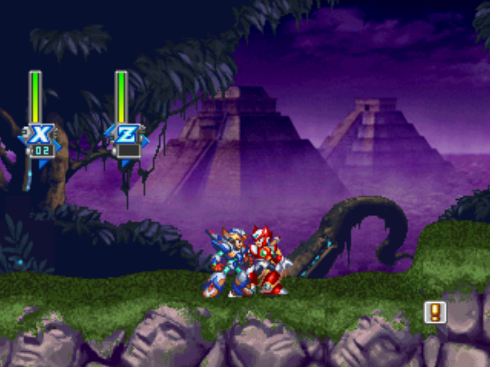

# Mega Man X6 co-op

Play as **X (player one)** and **Zero (player two)** on a shared screen. Each
hero has separate health and weapons; lives belong to the team. Co-op is
experimental. The opening-stage and selected encounter checks do not establish
that the whole campaign works.

## Play locally

1. Use your Mega Man X6 USA **v1.1 / SLUS-01395** disc image.
2. Select **OpenGL** in the launcher. Assign a different controller to each
   player in the controller settings.
3. Under **Mods**, enable **X + Zero Co-op**. It is off by default.
4. Start a new game or load your co-op progress through the game's own menu.

## Play over netplay

1. Both players need the **same build** and supported disc revision.
2. Each player selects their own controller on the launcher's **P1/Netplay**
   card. Open **Netplay**, then host or join the same session.
3. The host chooses the fixed **Netplay aspect** before starting. The supported
   choices are **4:3**, **16:9** and **21:9**. The guest follows the host.
4. Netplay enables co-op for both players. X is player one and Zero is player
   two. Your ordinary offline mod choices remain separate.

Netplay uses input delay. The reviewed captures below come from two Windows
peers on the same machine. Internet conditions and Windows/Linux sessions still
need separate validation.

## Controls

| Action | Control |
|---|---|
| Move, jump, dash and attack | Your character's original controls; check **Options** in the game for your button assignments. |
| Open your own pause menu | **Start**, while your hero can act. |
| Resume from that menu | The player who opened it presses **Start**. |
| Let Zero leave temporarily | Player two holds **Select** for 90 gameplay updates, about 1.5 seconds at normal speed. |
| Bring Zero back after a voluntary departure | Player two releases, then taps **Select**. Retained health is preserved. |

Voluntary departure is available to a living Zero during ordinary gameplay.
Death, shared scenes and team retries have their own rules. The surviving hero
can continue after a partner falls; a voluntary return does not reload the team
at a checkpoint.

Use the game's normal memory-card save menu for persistent progress. Keep a
backup of existing cards. Netplay save states, rewind and rollback are not
supported.

## HUD layout

The co-op mod's **HUD layout** offers **Stacked** (default) and **Side by side**.
Both retain each hero's native portrait, health and selected weapon meter. The
qualified build uses a shared camera.

Local opening-stage play, default stacked meters.

Local opening-stage play, side-by-side meters.

One peer's complete netplay image after native memory-card Load. The starting
progress was prepared for the check; this image does not demonstrate earning
that progress in a normal campaign.

These are unchanged composed-window captures from the same qualified local
build, **c32dd8f / SDK 7cb474**, reviewed on October 25, 2026. They illustrate
the documented shared-screen layouts. The published alpha and later development
builds have their own validation scope. See the [HUD review](docs/evidence/mmx6-hud/manifest-bound-c32dd8f-R6-both-modes-layouts-portraits-HP-ammo-reviewed.json)
and [remaining comparison checks](docs/COOP_PARITY_BURNDOWN.md).

## Current limits and reporting problems

The supported roster is X/player one and normal Zero/player two. Opposite-seat
characters, complete campaign progression, every vehicle and boss interaction,
long sessions and rematches remain under validation. Physical controllers,
Internet sessions and other hosts need checks beyond the automated Windows
captures shown here.

When reporting a problem, include your build, stage/checkpoint, player, HUD
layout and whether you played locally or over netplay. Include the startup log
and diagnostic recording when available. A screenshot is useful for art and
layout problems.

## License

The title's code is covered by the existing [PolyForm Noncommercial 1.0.0
license](LICENSE). Bundled OpenBIOS has its separate MIT license. Original game
data is supplied from your own disc; the game and third-party components retain
their respective rights and [attributions](mods/preloaded/ATTRIBUTION.md).
